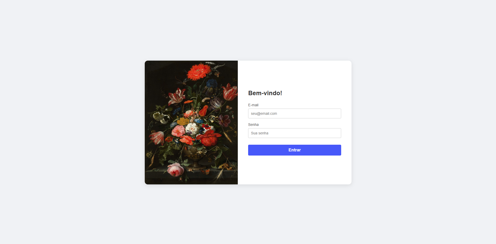
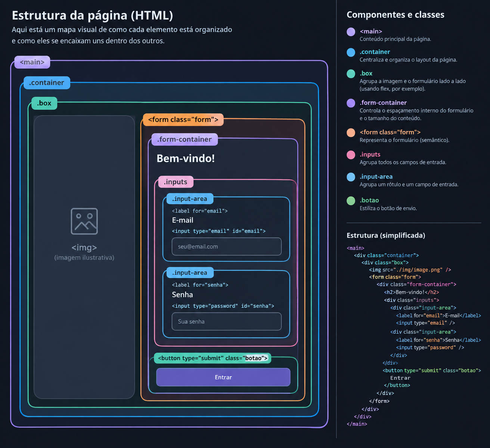

# Desenvolvimento Web

Nesta seção, vamos desenvolver uma página simples de login enquanto explico e comento cada etapa do processo.



## 1. Como funciona o HTML

Antes de tudo, abra o VS Code e crie um arquivo chamado `index.html`.

No arquivo, digite `html:5`. O VS Code deverá mostrar uma opção de autocomplete. Pressione **Enter** para gerar uma estrutura básica de HTML, semelhante a esta:

```html
<!DOCTYPE html>
<html lang="pt-br">
<head>
    <meta charset="UTF-8">
    <meta name="viewport" content="width=device-width, initial-scale=1.0">
    <title>Document</title>
</head>
<body>

</body>
</html>
```

Por enquanto, vamos trabalhar entre as tags `<body>` e `</body>`.

Para visualizar a interface, instale a extensão **Live Server** no VS Code. Depois da instalação, clique em **Go Live**, no canto inferior direito. A página será aberta no navegador, geralmente em um endereço como `http://127.0.0.1:5500`.

**Observação:** lembre-se de salvar o arquivo depois de cada alteração.

### 1.1. Elementos básicos do HTML

HTML é uma linguagem de marcação. Com ela, definimos os elementos da nossa interface.

Textos, imagens, ícones e outros elementos da página são definidos no HTML.

Por exemplo, escreva:

```html
<p>Teste</p>
```

A tag `<p>` é usada para criar um parágrafo. O texto escrito entre as tags aparecerá na página com a formatação padrão do navegador.

Agora, escreva logo abaixo:

```html
<h1>Título</h1>
```

A tag `<h1>` representa o título principal da página. Por padrão, ele aparece maior e em negrito, mas sua aparência pode ser alterada com CSS.

Também temos a tag de botão. Escreva:

```html
<button>Cadastrar</button>
```

Agora você verá um botão básico na interface.

### 1.2. Organizando os elementos com `div` e `class`

Certo, agora que temos esses elementos no HTML, precisamos organizá-los para conseguir estilizá-los da forma que queremos. Para isso, podemos usar a tag `<div>`.

Sozinha, a `div` não muda necessariamente a aparência dos elementos. Ela serve como um contêiner para agrupar componentes que precisam ser organizados ou estilizados em conjunto.

Por exemplo:

```html
<div>
    <h2>Bem-vindo</h2>
    <p>Preencha suas credenciais</p>
</div>
```

Para identificar essa `div` no CSS, podemos atribuir a ela um nome usando o atributo `class`:

```html
<div class="boasVindas">
    <h2>Bem-vindo</h2>
    <p>Preencha suas credenciais</p>
</div>
```

Agora, no CSS, podemos selecionar essa classe usando `.boasVindas` e definir a estilização desejada.

O atributo `class` pode ser usado em diferentes elementos HTML. Também podemos criar classes para elementos como `<h2>` e `<p>` quando isso ajudar a organizar e controlar melhor a estilização.

### 1.3. Estrutura HTML do projeto

Abra o arquivo `index.html` dentro da pasta `src` e observe a estrutura.

Isolei o conteúdo principal dentro de um componente `<main>`, que fica dentro do `<body>`. Assim, podemos configurar o conteúdo principal sem precisar aplicar todas as regras diretamente ao `body`.

Dentro de `main`, criei uma `div` chamada `container`, que reúne o conteúdo. Ter um contêiner principal facilita a centralização e outras estilizações.

Depois, criei uma `div` chamada `box`, que representa a caixa central da página. Dentro dela, temos duas áreas: o lado esquerdo, com a imagem, e o lado direito, com o formulário.

No lado esquerdo, adicionei uma imagem com a tag ``. No lado direito, criei uma `div` para o formulário, onde ficam os textos, os campos de entrada (*inputs*) e os botões.

A área dos inputs foi separada para que seus elementos possam receber regras próprias de espaçamento e estilização.

E pronto: a estrutura HTML está feita.

Esta imagem representa a organização dos componentes:



Vale ressaltar que, na parte superior do HTML, temos uma linha semelhante a esta:

```html
<link rel="stylesheet" href="./style.css">
```

Essa linha conecta o HTML ao arquivo CSS. O atributo `rel="stylesheet"` indica que o arquivo vinculado é uma folha de estilos, e `href="./style.css"` informa o caminho do arquivo.

O atributo `type="text/css"` também pode ser usado, mas é desnecessário em HTML5, pois `text/css` já é o tipo padrão para folhas de estilo.

## 2. Como funciona o CSS

O CSS é usado para definir a aparência dos elementos HTML. Depois de vincular o arquivo CSS ao HTML, podemos selecionar os componentes e aplicar estilos.

### 2.1. Selecionando elementos e classes

Para selecionar uma classe definida no HTML, usamos um ponto (`.`) seguido do nome da classe.

Por exemplo, considerando este HTML:

```html
<div class="conteudo">
</div>
```

No arquivo CSS, podemos escrever:

```css
.conteudo {
    /* Estilos da classe conteudo */
}
```

Tudo o que definirmos entre as chaves será aplicado aos elementos que tiverem a classe `conteudo`.

Também podemos selecionar diretamente uma tag:

```css
div {
    /* Estilos aplicados a todas as divs */
}
```

Nesse caso, os estilos serão aplicados a todas as tags `<div>` da página.

Da mesma forma, podemos selecionar o `body`:

```css
body {
    /* Estilos aplicados ao body */
}
```

Quando queremos selecionar uma classe, usamos um ponto antes do nome:

```css
.botao {
    /* Estilos aplicados aos elementos com a classe botao */
}
```

Todos os elementos que tiverem a classe `botao` receberão esses estilos. Isso é útil quando queremos padronizar vários componentes.

Por exemplo, se quisermos que todos os inputs tenham a mesma aparência, podemos atribuir a mesma classe a eles e estilizar essa classe no CSS.

### 2.2. CSS no projeto

Para começar, usamos o seletor universal `*` para aplicar estilos a todos os elementos:

```css
* {
    margin: 0;
    padding: 0;
}
```

Aqui, zeramos `margin` e `padding`, removendo os espaçamentos padrão que os navegadores aplicam a vários elementos. Assim, podemos definir os espaçamentos de acordo com o layout desejado.

Depois, precisamos definir a altura do `body`, ou seja, quanto ele ocupará da tela:

```css
body {
    height: 100vh;
}
```

A unidade `vh` representa uma porcentagem da altura da área de visualização (*viewport*). Portanto, `100vh` corresponde à altura total da área de visualização.

Defino uma altura semelhante para o `main` e para `.main-container`, para que também ocupem toda a altura da área de visualização. Existem outras formas de organizar isso, mas, por enquanto, vamos usar uma abordagem básica.

Em seguida, quero centralizar os elementos filhos de `.main-container`. Para isso, uso `display: flex`. Existem outros tipos de `display`, mas prefiro trabalhar com Flexbox; dependendo do layout, outras opções também podem ser mais adequadas.

Com o Flexbox, podemos usar duas propriedades importantes:

```css
.main-container {
    display: flex;
    align-items: center;
    justify-content: center;
}
```

- `align-items`: alinha os elementos no eixo transversal.
- `justify-content`: distribui ou alinha os elementos no eixo principal.

Quando usamos `flex-direction: row`, o eixo principal é horizontal e o transversal é vertical. Por isso, nesse caso, `justify-content: center` centraliza horizontalmente e `align-items: center` centraliza verticalmente. Se mudarmos a direção para `column`, os eixos se invertem.

No `.box`, defino a altura (`height`) e a largura (`width`) usando `rem`, uma unidade relativa ao tamanho da fonte do elemento raiz (`html`). Em navegadores com a configuração padrão, `1rem` normalmente equivale a `16px`. Podemos ajustar os valores até encontrar um tamanho adequado para a caixa.

Em seguida, vou estilizar o efeito de sombra que faz a caixa parecer elevada. Para isso, usamos `box-shadow`, que pode receber valores como `1px 1px 10px color`.

- O primeiro valor representa o deslocamento horizontal da sombra.
- O segundo valor representa o deslocamento vertical.
- O terceiro valor define o desfoque da sombra.
- O último valor define a cor.

Depois, vamos arredondar os cantos da caixa com `border-radius`. Quanto maior o valor, mais arredondados serão os cantos.

Por último, definimos a cor de fundo da caixa com `background-color`. Neste caso, usamos `white`.

Observe que, em `.box img`, estamos selecionando uma tag `` que está dentro de um elemento com a classe `.box`. O CSS permite selecionar elementos com base nessa relação.

No `img`, usamos `border-top-left-radius` e `border-bottom-left-radius`. Essas propriedades arredondam apenas os cantos especificados: o superior esquerdo (*top left*) e o inferior esquerdo (*bottom left*).

### 2.3. Estilizando o formulário

Na classe `.form`, começo definindo `width: 100%`. Isso faz com que o formulário tente ocupar toda a largura disponível do seu contêiner. A largura efetiva depende do espaço disponível e das regras de layout aplicadas aos elementos ao redor.

Logo depois, uso `display: flex` para organizar os elementos e `flex-direction: column` para colocar os elementos filhos de `.form` em coluna, um abaixo do outro.

Depois, defino um `gap`, que controla o espaçamento entre os elementos filhos do contêiner flexível. Você pode testar valores diferentes e observar como a distância entre os componentes muda.

No `h2`, apenas mudamos a cor do texto usando `color`.

Na classe `.inputs`, fazemos configurações que já vimos: usamos Flexbox, definimos o espaçamento com `gap` e configuramos `width: 100%`.

No `input`, fazemos algo novo: definimos o `padding`.

`padding` é uma propriedade CSS que controla o espaçamento interno de um elemento. É parecido com `margin`, mas existe uma diferença:

- `margin` controla o espaçamento externo ao redor do elemento.
- `padding` controla o espaço interno, entre o conteúdo e a borda do elemento.

Altere os valores para mais e para menos e observe a diferença.

Depois, configuramos a borda dos inputs com `border`, que pode receber três valores:

1. A espessura da borda.
2. O estilo da linha — por exemplo, `solid` para uma linha contínua.
3. A cor da borda.

### 2.4. Estilizando o botão e criando uma transição

Para finalizar, temos o `button`. Aqui, aparecem três propriedades importantes.

Uma delas é `cursor`, que define o cursor exibido quando o ponteiro passa sobre um elemento. No nosso caso, usamos `pointer`, que normalmente mostra o cursor em formato de mão.

Também temos `transition`, que controla a transição entre os estados de uma propriedade CSS. Mas por que usamos isso?

A resposta está em `button:hover`.

Quando selecionamos um componente com `:hover`, definimos estilos que serão aplicados enquanto o ponteiro estiver sobre ele. Aqui, vamos reduzir a opacidade para 70%:

```css
button {
    cursor: pointer;
    transition: opacity 0.5s;
}

button:hover {
    opacity: 0.7;
}
```

Ao passar o ponteiro sobre o botão, a opacidade diminui. A propriedade `transition` faz essa mudança acontecer gradualmente, em vez de ocorrer de forma instantânea.

Agora, faça um teste:

1. Passe o ponteiro sobre o botão e observe a transição.
2. Remova `transition: opacity 0.5s` e passe o ponteiro novamente. A mudança será instantânea.
3. Adicione a transição novamente e aumente o tempo para `5s`. Você verá que a opacidade demora mais para chegar ao novo valor.

Esse é um exemplo simples de como podemos melhorar a experiência visual com CSS.

## 3. Conclusão

Essas habilidades são desenvolvidas com a prática, pois o desenvolvimento visual envolve observar a interface e decidir o que precisa ser ajustado. Ao olhar para uma página, você pode perceber que precisa de uma fonte maior, cantos arredondados ou uma sombra. Se ainda não souber como fazer isso, pode pesquisar a propriedade CSS adequada.

Algumas propriedades aparecem com frequência, como as que vimos aqui. Com a prática, você vai se familiarizar com elas e lembrar melhor de como usá-las.

O ponto que considero mais importante é entender a lógica de organização dos componentes e aprender a estruturar o HTML de uma forma que facilite a estilização com CSS.
